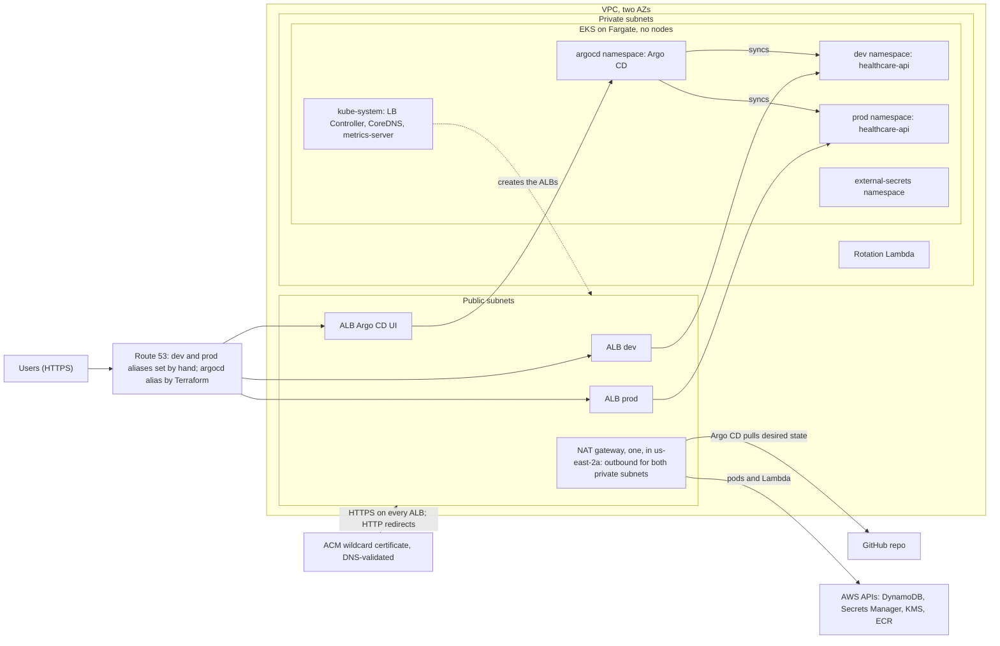
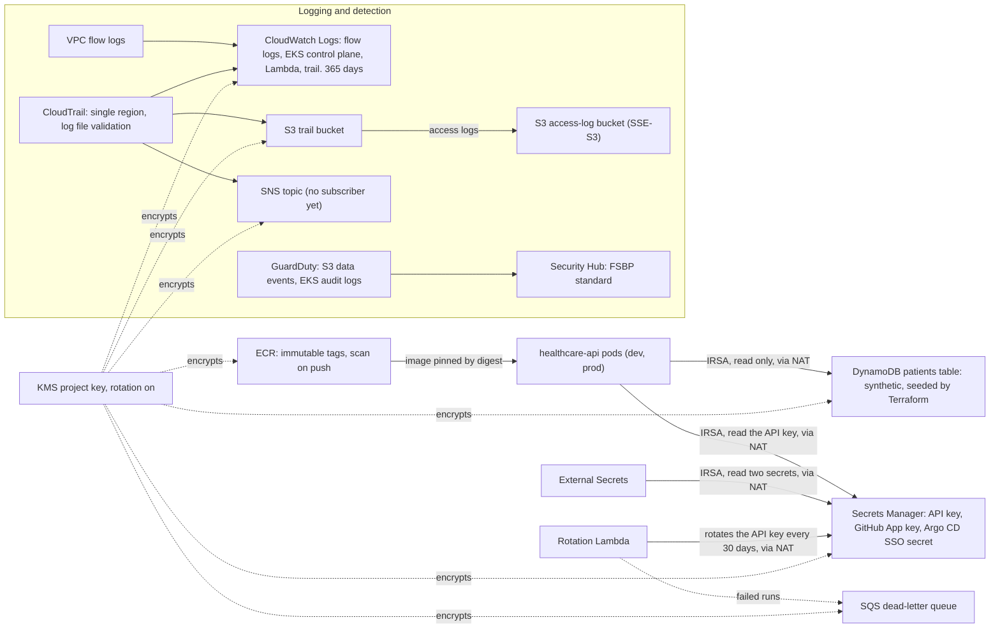
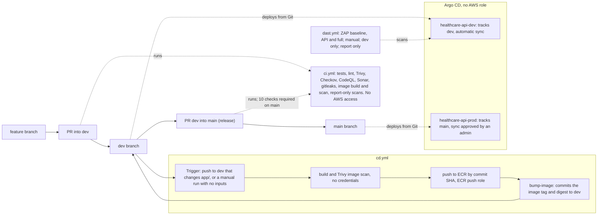
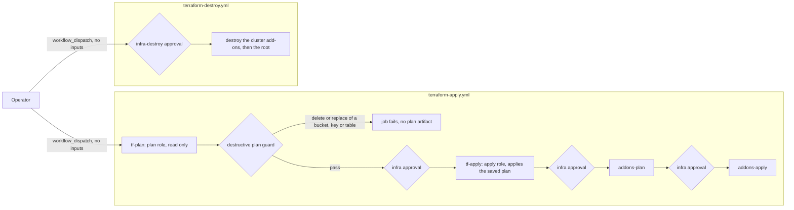
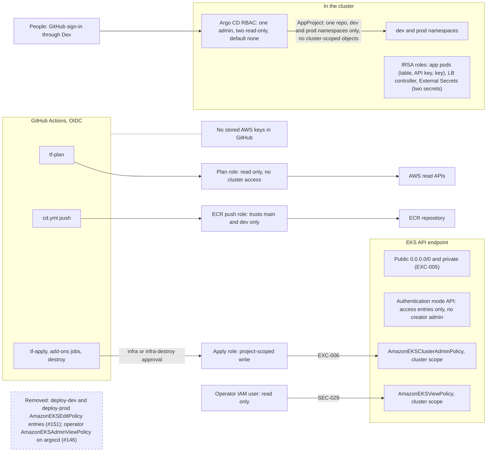

# Architecture

> Torn down on 2026-10-20. Hosted zone and domain retained by decision; see docs/runbooks/teardown.md.

Five diagrams: traffic and workloads, data and logging, app delivery, infrastructure delivery, and access. Region us-east-2. Diagrams are Mermaid and render on GitHub. Status at 2026-10-18.

## 1. AWS stack

### 1a. Traffic and workloads

### 1b. Data, encryption and logging

**Network path.** Pods and the Lambda reach DynamoDB, Secrets Manager, KMS and ECR through the one NAT gateway, because no VPC endpoints are built. The per-namespace pod security groups are created in `terraform/modules/eks/main.tf`; the `SecurityGroupPolicy` that attaches them is owned by `terraform/cluster-addons` (SEC-032). Kubernetes NetworkPolicy is not enforced on Fargate (SEC-021). The EKS API endpoint stays public and private (EXC-005). Fargate profiles: kube-system, argocd, external-secrets, dev and prod.

**References.** SEC-001 and SEC-002 (network, flow logs); SEC-021, SEC-030 and SEC-032 (pod isolation, Pod Security); SEC-003 and SEC-027 (rotation; pods are restarted by hand after a rotation, SEC-034); SEC-022 and SEC-023 (read-only seeded table); SEC-035 to SEC-037 (detective controls); EXC-010 (single-region trail); EXC-014 (access-log bucket on SSE-S3, which S3 access logging requires). AWS Config, WAF and Inspector are not built.

### Availability: single NAT gateway

One NAT gateway in `us-east-2a` serves both private subnets, which share one private route table (`terraform/modules/network/main.tf`). It is one gateway for cost. If that AZ fails, outbound calls to DynamoDB, Secrets Manager, KMS and ECR fail for pods in both AZs. The table and the secret stay available, because both are regional services. Accepted as EXC-015.

Planned fixes, not built: a second NAT gateway with its own private route table per AZ, a DynamoDB gateway endpoint, and interface endpoints for Secrets Manager, KMS, STS, ECR and CloudWatch Logs.

## 2. Delivery

### 2a. App delivery

### 2b. Infrastructure delivery

Environment approvals are set by hand in GitHub: `infra` and `infra-destroy` each have one required reviewer (the maintainer), self-review allowed and admin bypass on ([bootstrap.md](bootstrap.md), EXC-003). Deploys come from Git through Argo CD; no workflow runs Helm or kubectl against the cluster ([gitops-deploy.md](runbooks/gitops-deploy.md)). Some steps around a rebuild stay manual ([bootstrap.md](bootstrap.md), Manual steps around a rebuild). References: SEC-011 (CI and CD split), SEC-016 (apply uses the saved plan and Lambda zip), SEC-031 (deploy by digest), SEC-037 (destructive plan guard), EXC-003 (0 required approvals on `main`).

## 3. Access model

References: EXC-004 (the plan role trusts pull requests), EXC-005 and SEC-018 (public endpoint), EXC-006 and SEC-019 (the apply role is cluster admin), SEC-029 (operator access entry). The operator IAM user has a long-lived access key and no MFA (Prowler triage N2). The deploy-dev and deploy-prod IAM roles are unused since 2026-10-15; their EKS access was removed 2026-10-18 (#151, applied), and the roles remain until deleted by hand.
