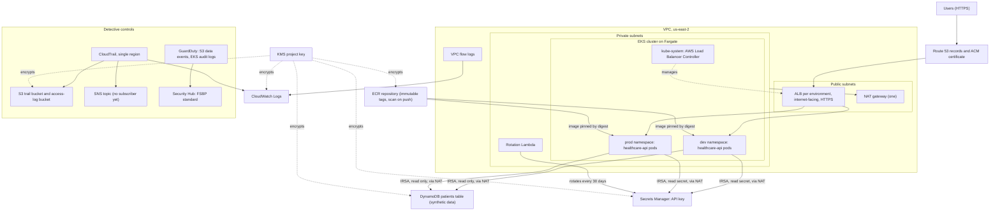
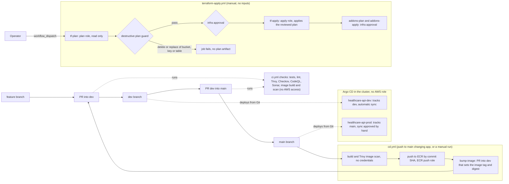
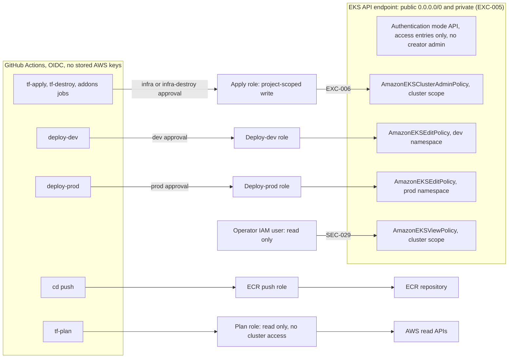

# Architecture

Three views of the finished stack: the AWS architecture, the CI/CD flow and the access model. The diagrams are Mermaid and render on GitHub. Region us-east-2. No account IDs or ARNs; names are generic.

## 1. AWS architecture

Network path: pods reach DynamoDB and Secrets Manager through the single NAT gateway, because no VPC endpoints are built. The per-namespace pod security groups are created in `terraform/modules/eks/main.tf`; only the `SecurityGroupPolicy` that attaches them is owned by `terraform/cluster-addons` (SEC-032). The EKS API endpoint stays public (EXC-005).

References: SEC-001, SEC-002 (network and flow logs), SEC-021, SEC-030, SEC-032 (pod isolation and Pod Security), SEC-003, SEC-027, SEC-034 (rotation), SEC-022, SEC-023 (read-only seeded table), SEC-035 to SEC-037 (detective controls). The access-log bucket uses SSE-S3, not the project key (EXC-014). AWS Config, WAF and Inspector are not part of the stack (deferred, see the README).

### Availability: single NAT gateway

One NAT gateway in `us-east-2a` serves both private subnets, which share one private route table (`terraform/modules/network/main.tf:56-70`, `:83-92`). It is one gateway for cost: the comment at `:56` says "cost saving". If that AZ fails, outbound calls to DynamoDB, Secrets Manager, KMS and ECR fail for pods in both AZs. The table and the secret themselves stay available, because both are regional services. The risk is accepted as EXC-015.

Planned fixes, not built (no Terraform exists for any of them): a second NAT gateway with its own private route table per AZ, a DynamoDB gateway endpoint, and interface endpoints for Secrets Manager, KMS, STS, ECR and CloudWatch Logs.

## 2. CI/CD flow

`terraform-destroy.yml` is separate: manual, no inputs, behind its own `infra-destroy` approval. Environment approvals are configured by hand in GitHub (documented in [security/controls.md](security/controls.md)). Deploys come from Git through Argo CD; no workflow runs Helm or kubectl against the cluster ([runbooks/gitops-deploy.md](runbooks/gitops-deploy.md)). References: SEC-011 (ci and cd split), SEC-031 (deploy by digest), SEC-037 (destructive plan guard), EXC-003 (0 required approvals on `main`).

## 3. Access model

References: EXC-004 (plan role trust for pull requests), EXC-005 and SEC-018 (public endpoint), EXC-006 and SEC-019 (apply role is cluster admin), SEC-029 (operator access entry). The operator IAM user has a long-lived access key (SEC-029 residual risk) and no MFA (Prowler triage N2).

Rendering note: the Mermaid blocks were checked by reading, not rendered in a browser.
