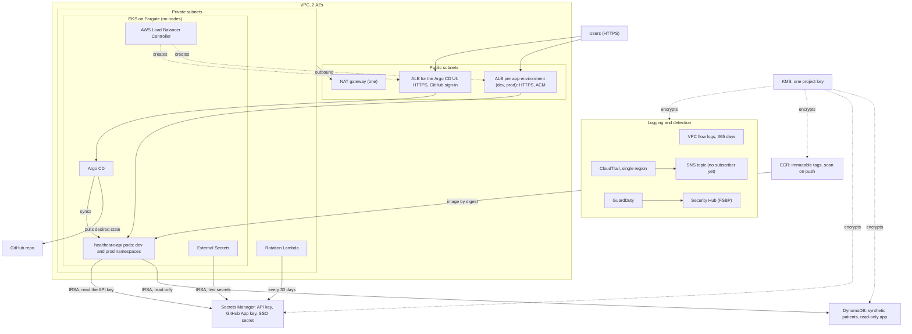
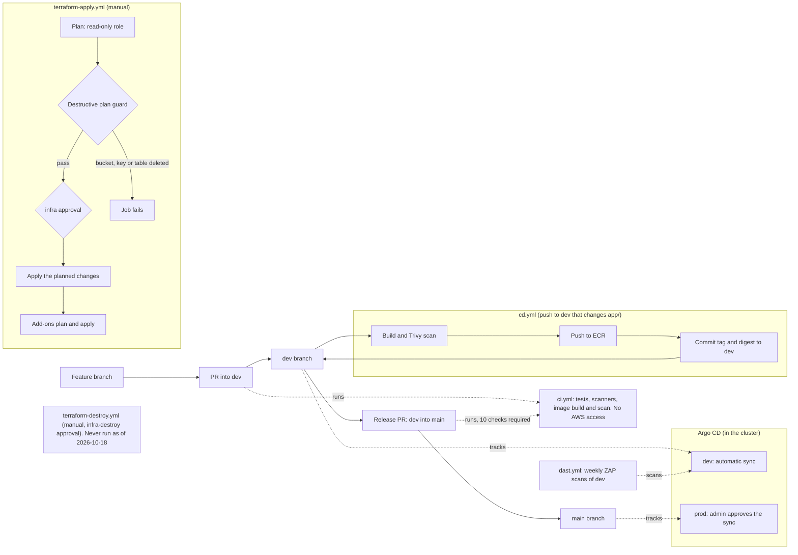
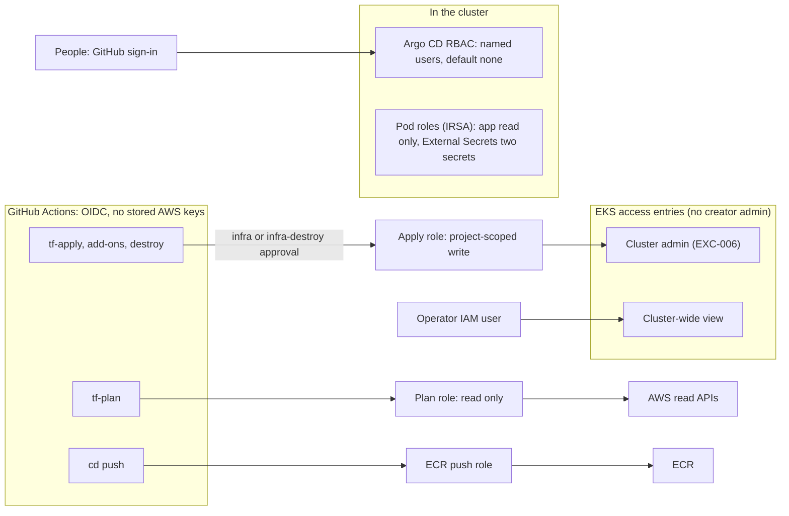

# Architecture

Three views: the AWS stack, the delivery flow and the access model. Region us-east-2. Diagrams are Mermaid and render on GitHub.

## 1. AWS stack

- Pods reach AWS APIs through the one NAT gateway. No VPC endpoints are built.
- Each app namespace has its own pod security group, attached by a `SecurityGroupPolicy` (SEC-032). Kubernetes NetworkPolicy is not enforced on Fargate (SEC-021).
- The EKS API endpoint is public and private, with access entries only (EXC-005).
- AWS Config, WAF and Inspector are not built.

### Single NAT gateway

One NAT in `us-east-2a` serves both private subnets (`terraform/modules/network/main.tf`). If that AZ fails, pods in both AZs lose outbound calls to DynamoDB, Secrets Manager, KMS and ECR. Accepted for cost as EXC-015. The fix, not built: a NAT and route table per AZ, plus VPC endpoints.

## 2. Delivery flow

- No workflow runs Helm or kubectl against the cluster. Argo CD deploys from Git ([gitops-deploy.md](runbooks/gitops-deploy.md)).
- Merges are gated by automated checks; `main` requires 0 approvals (EXC-003).

## 3. Access model

- The plan role trusts pull requests (EXC-004). The apply role is cluster admin (EXC-006).
- The operator has a long-lived access key and no MFA (Prowler triage N2).
- Removed: the operator's break-glass read on `argocd` (#146), and EKS access for the deploy-dev and deploy-prod roles, removed 2026-10-18 (#151, applied). The two IAM roles remain until deleted by hand.
